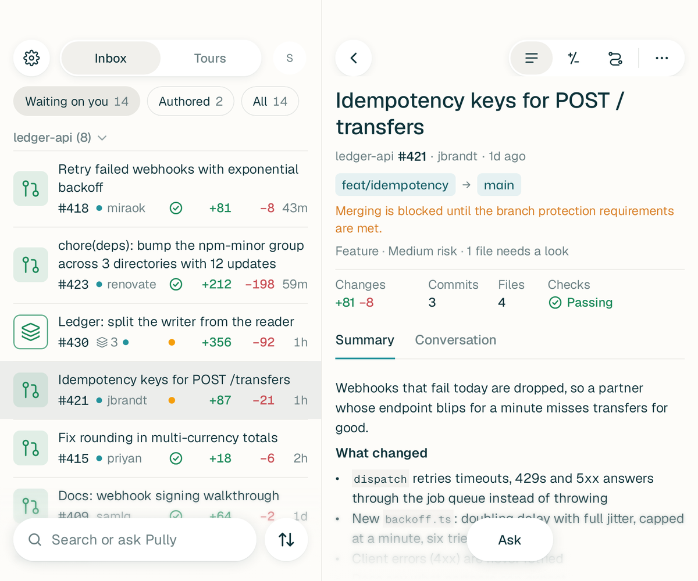

<p align="center">
  
</p>

# Pully

Review GitHub pull requests on your phone. Pully groups a pull request's files by what they do,
writes a short summary and a guided tour through the change, and lets you ask questions about it
or have Claude Code or Codex review it, all from an Android app built for one-handed reading.

> [!NOTE]
> Pully is a personal project under active development. The Android app is the product and the
> iPhone app runs the same shared screens on real data; the web app trails behind both.

## What it does

- **Inbox.** Pull requests waiting on you, the ones you wrote, and stacks of pull requests shown
  as one row. Group them by kind and see the riskiest first. The Inbox updates by itself while
  it is open, and every pull request on it is read ahead, so tapping one opens it at once.
- **Overview, Diff and Tour.** A summary of what changed and why, the description and
  conversation as GitHub shows them (Mermaid diagrams drawn on the phone), a diff that reads
  like code, and a Tour that walks through the change in a sensible order.
- **Ask.** Ask anything about a pull request or your whole Inbox, with the chat history kept.
- **Review with AI.** Claude Code, Codex or Pi (any model behind your own API) reviews the pull request with a chosen set of review
  skills, and you pick which findings to post back to GitHub. Each person signs in to their own
  Claude Code and Codex subscription in Settings; no API keys.
- **Explore.** Browse public GitHub projects and open their pull requests without signing in.
- **Diff links for agents.** Coding agents post a diff with an agent key and hand you a link that
  opens like a pull request ([`skills/post-diff-to-pully`](./skills/post-diff-to-pully)).
- **Made for the phone.** Gestures that follow your finger, sheets, haptics and sounds, light and
  dark colour themes, two panes on an unfolded foldable, alerts for the checks and AI work you
  follow, and in-app updates with a What's new sheet.

Every release is described, with pictures, in [`android/CHANGELOG.md`](./android/CHANGELOG.md).

## How it fits together

```
 Android app  ─┐
 iPhone app   ─┼──  Pully server (Rust)  ──  GitHub, Claude Code, Codex
 Web app      ─┘     native, or on Cloudflare Workers
```

- **Phone apps.** Kotlin with Compose. Android and iOS share their domain, client and UI code
  through Kotlin Multiplatform ([`mobile/`](./mobile)); [`android/`](./android) and
  [`ios/`](./ios) are the two hosts.
- **Server.** [`backend/`](./backend) is one Rust crate that builds both the native server and
  the Cloudflare Worker in [`packages/worker`](./packages/worker), which keeps the server's data
  in a Durable Object and runs each login's AI in its own container. The server keeps every
  pull request it has read and tells phones what changed, so the apps read from their own copy
  first and catch up quietly ([plan 14](./plans/14-sync-engine.md)).
- **Sign-in.** A Pully account with Google; GitHub is connected the way `gh auth login` does it.
- **Web.** [`packages/app`](./packages/app) is the Vue web app, styled from the same design
  tokens as the phone.

## Repository layout

| Path                                     | What it is                                                                            |
| ---------------------------------------- | ------------------------------------------------------------------------------------- |
| [`android/`](./android)                  | The Android app, its design rules ([`DESIGN.md`](./android/DESIGN.md)) and changelog. |
| [`ios/`](./ios)                          | The iPhone host for the shared app.                                                   |
| [`mobile/`](./mobile)                    | Kotlin Multiplatform code shared by Android and iOS.                                  |
| [`backend/`](./backend)                  | The Rust server: GitHub, review state, AI runs, accounts, sync.                       |
| [`packages/worker`](./packages/worker)   | The same server built for Cloudflare Workers.                                         |
| [`packages/app`](./packages/app)         | The Vue web app.                                                                      |
| [`packages/core`](./packages/core)       | Diff parsing, providers and analysis used by the web app and the Action.              |
| [`packages/cli`](./packages/cli)         | A small launcher that serves the web app from a local Rust server.                    |
| [`packages/actions`](./packages/actions) | The CLI behind the GitHub Action in [`action.yml`](./action.yml).                     |
| [`skills/`](./skills)                    | Agent skills for posting diffs to Pully and reading in-app feedback.                  |
| [`plans/`](./plans), [`docs/`](./docs)   | Design plans and notes on the server, releases and migrations.                        |

## Development

You need Node.js 24 with pnpm, Rust, and for the app JDK 21 and the Android SDK.

```sh
pnpm install

# Android app: unit tests and a debug APK
cd android && ./gradlew :app:testDebugUnitTest :app:assembleDebug

# Server
cargo test --manifest-path backend/Cargo.toml
cargo run --manifest-path backend/Cargo.toml   # see backend/README.md for settings

# Cloudflare Worker, locally
pnpm -F @pulls.review/worker dev

# Checks that run in CI
pnpm run lint && pnpm run typecheck
pnpm run contracts:check && pnpm run android:design
```

Code rules live in `CONTRACTS` files beside the code they govern, and the Android look is set
by [`android/DESIGN.md`](./android/DESIGN.md); [`CLAUDE.md`](./CLAUDE.md) explains both.

## Releases

`main` is the integration branch: each merge deploys the Cloudflare server as staging and
publishes Pully Staging, a separate app that installs beside Pully. Stable releases go out from
the `release` branch through a promotion pull request that runs the full Android, iOS and server
checks. [`docs/RELEASE_TRACK.md`](./docs/RELEASE_TRACK.md) has the details.

## Credits

Pully started as a fork of [pulls.review](https://github.com/antfu/pulls.review) by
[Anthony Fu](https://github.com/antfu), which was itself inspired by
[Linear's PR review guides](https://linear.app/docs/diffs#guides).

## License

[MIT](./LICENSE)
