# What's new in Pully

<!--
One section per version, newest first, headed with the versionName from app/build.gradle.kts.
The first paragraph is the summary: one short sentence (70 characters at most, the notification
shows two short lines) that the update notification and the published latest.json use. The
bullets under it are what the What's new sheet lists.

Write for the person holding the phone: what they will see or can now do, in plain words. No
rule numbers, file names or component names. A pull request that bumps the version adds its
section here; `pnpm run android:design` fails when the version has none. The app bundles this
file, and android/scripts/publish-apk.sh puts it in latest.json.

From 0.40.0 on every section shows what changed in pictures, a short GIF where it moves:
`` on its own unindented line under the bullet
it shows. The files live in android/changelog/<version>/, at most 2 MB each.
-->

## 0.50.0

A stack's list now shows each pull request's number and author.

### Changed

- The list a stack opens shows each pull request the way the Inbox does: its number and who opened it under the title, with its place in the stack, such as 2/3, on the left.
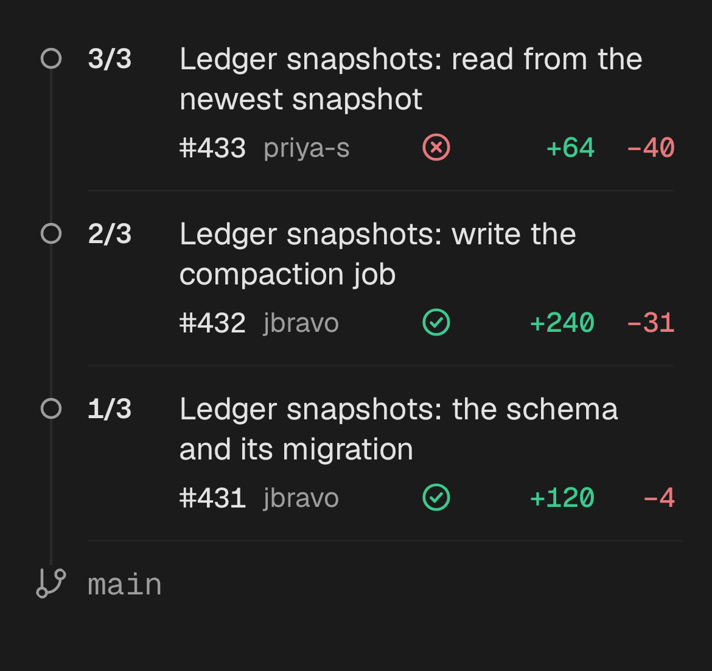

## 0.49.0

Long titles get a second line, and a stack is one row in the Inbox.

### Changed

- In the Inbox, Tours and a repository's list, a long title wraps onto a second line and ends in an ellipsis only after that. A short title stays on one line, and the icon beside it stays the same size.
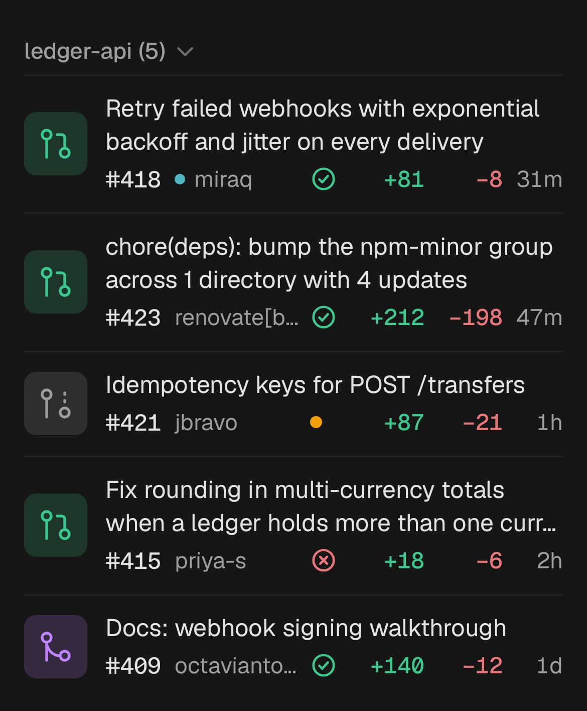
- The pull requests of one stack are now a single row in the Inbox, showing how many there are, their checks and their changes together. Tap it to see every pull request in the stack, from the top one down to the branch they merge into, and tap one to open it.
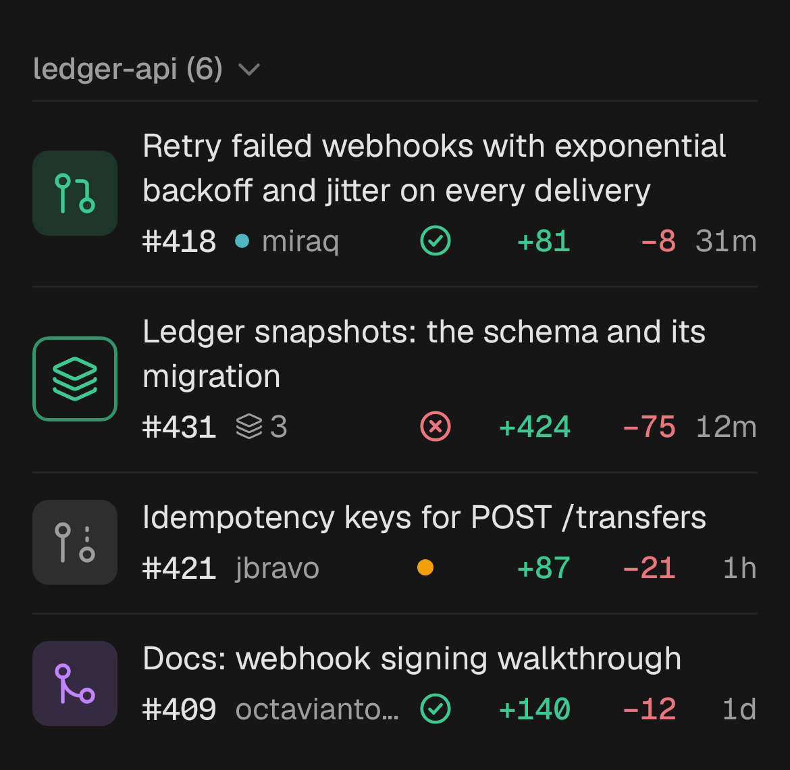
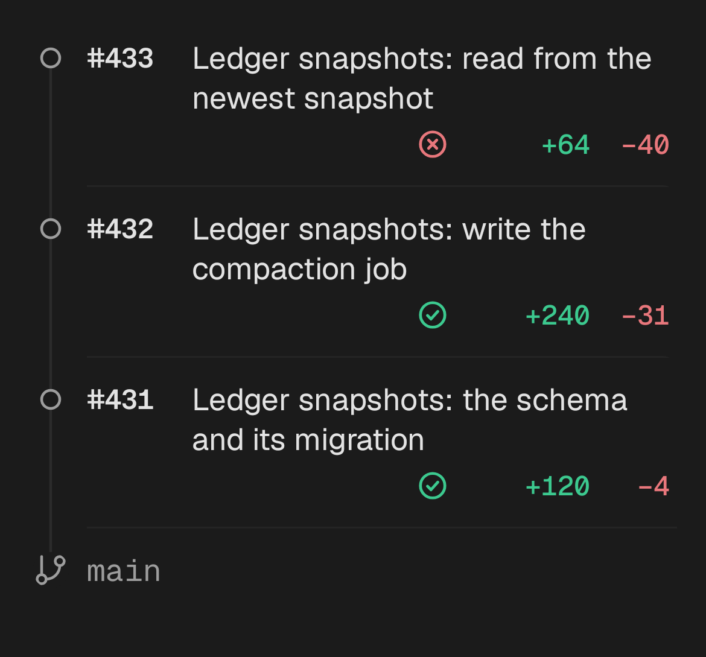

## 0.48.0

One bar at the foot of every page; descriptions read as you type.

### Changed

- The search and Ask bars are one bar now. Opening a pull request keeps it where it is: only its words change, and the sort button fades away beside it.
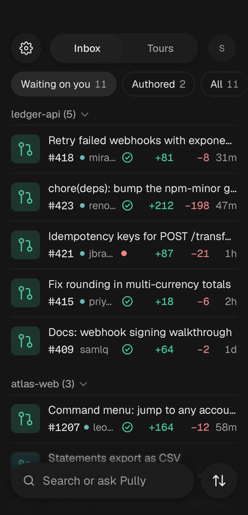
- On a pull request and a tour, the Ask bar rests short and just says Ask. Tap it and it opens with the keyboard; leave it empty and it goes short again. A tap on the bar never opens what is under it.
- Pull request rows are two lines at most: a long title ends in an ellipsis, and the icon beside it is bigger, nearly as tall as the row. A repository's list no longer shows labels under the title.
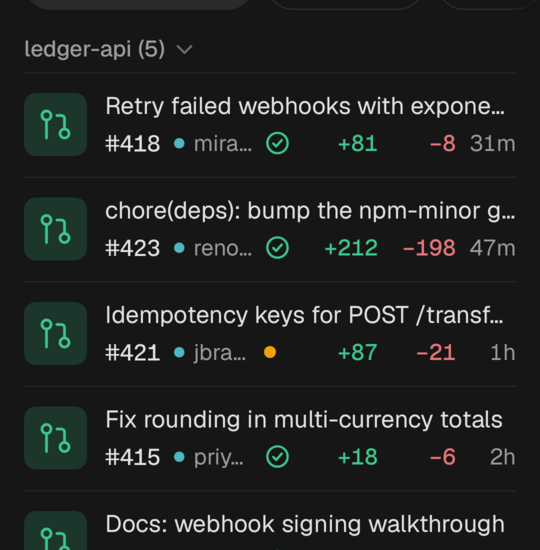
- Editing a description shows it formatted as you type, headings, bold, code and bullets, with the Markdown marks tucked away except on the line you are on. It opens where you tapped, not at the end.
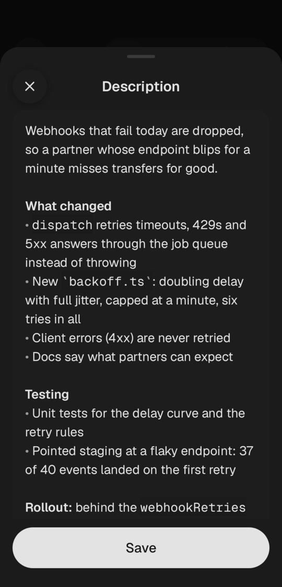

### Fixed

- In the diff, swiping back to the file you started on works; it no longer slides you back to the file you were on.
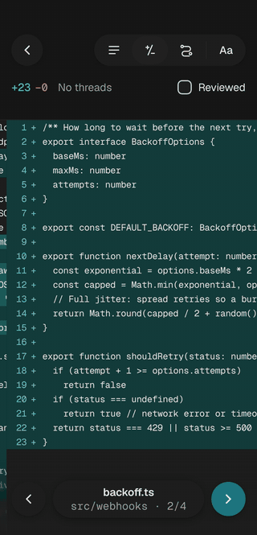

## 0.47.0

Pully remembers your Inbox tab, and every Ask bar works the same.

### Changed

- The Inbox opens on the tab you picked last, Waiting on you, Authored or All, and the choice follows you to your other phones.
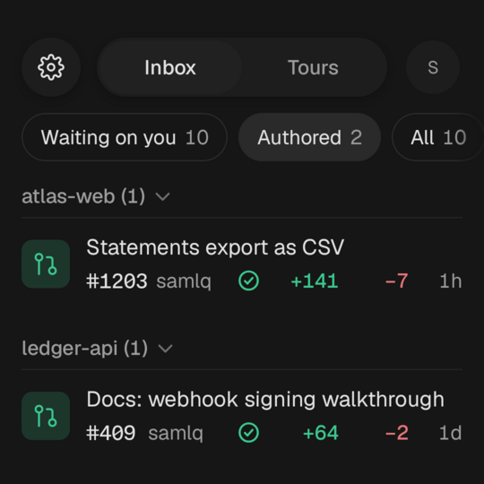
- A pull request's Ask bar works like the tour's: its button opens your earlier chats, and once you type it sends. The highlighted arrow beside it is gone; the changes are in the header and Approve is in ⋯.
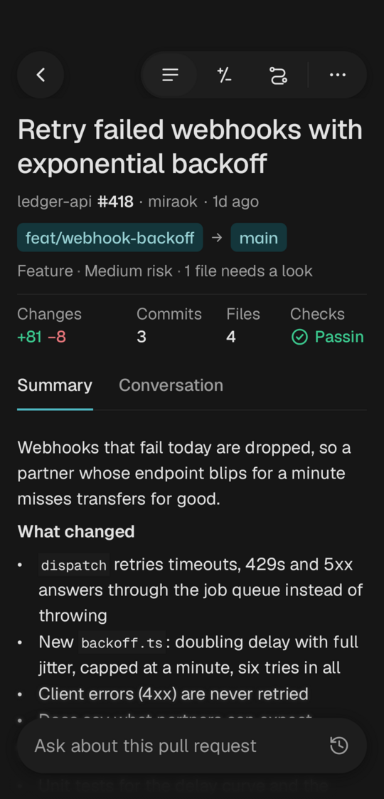
- The search and Ask bars sit at the same height on every page, so nothing jumps when you open a pull request.
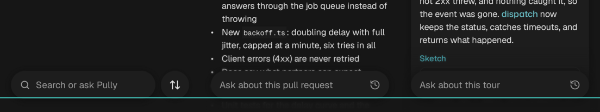
- The earlier-chats button only shows when there are earlier chats, and it opens just the list. Pick one and the chat opens.

## 0.46.0

A new server underneath, and AI findings post exactly as you picked.

### Fixed

- The line under a pull request's title stays on one line. A long repository or author name gives way at its end, so the number and age always show.
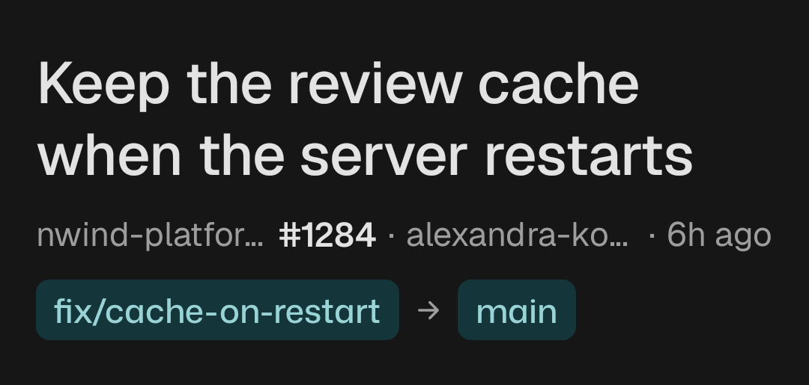
- Posting findings from an AI review posts exactly the ones you picked, for the commit on screen. If a newer review arrives meanwhile, it starts with nothing picked.
- Colours fill in on very long files instead of leaving some lines plain.
- Updates download only from your own server, never from a link elsewhere.

## 0.45.0

Sign in to Pully with Google, no account to create first.

### New

- The sign-in page leads with Continue with Google. Pick your Google account in the sheet that opens and you are in; the first time, Pully makes your account then and there.
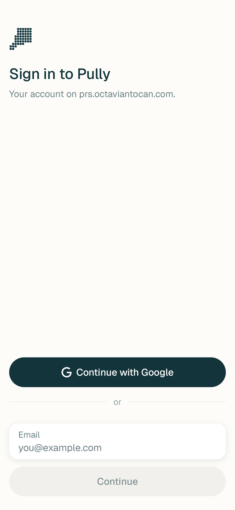
- Google sign-in is open to tocanoctavian@gmail.com and anyone at octaviantocan.com. Other Google accounts are turned away.
- Under it the email field stands alone. Continue brings up the password, for the test account; nobody can make an account with a password.

## 0.44.0

A pull request now shows its latest description the moment it opens.

### Fixed

- A pull request opened again, or from a link an agent sent after changing it, shows the title and description GitHub holds now within a moment, instead of the copy from your last visit until everything else loads.
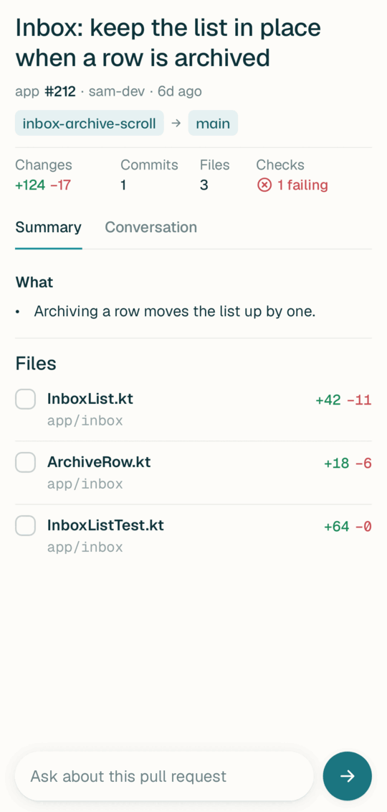
- Tapping a link to the pull request already on screen reads it again, so a change made meanwhile shows without leaving the page.

## 0.43.0

Agents can post a diff to Pully and hand you a link to review.

### New

- Agents can send Pully a diff with a key from your account and get back a link. It opens like a pull request, with the agent's own grouping, tour and review when it sends them, and without the branches and checks a bare diff does not have.
- Diffs agents post sit together at the top of the Inbox, under Posted by agents in their own colour. Tap one to review it, or hold it to delete it.
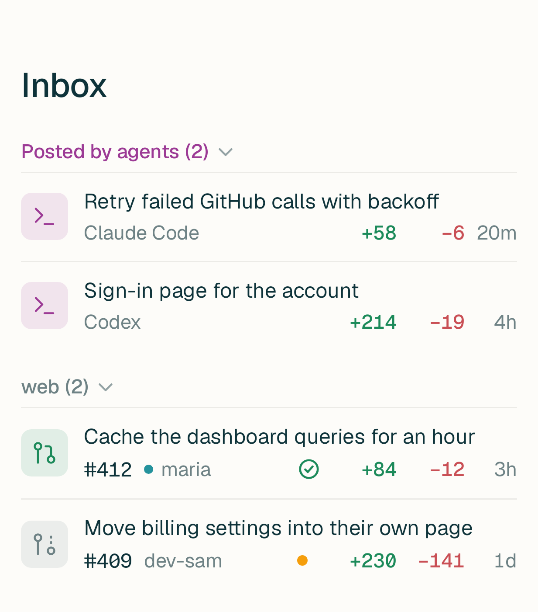
- Settings has an Account section and an Agent keys page: name a key, copy it once to give your agent, and revoke it when you are done.
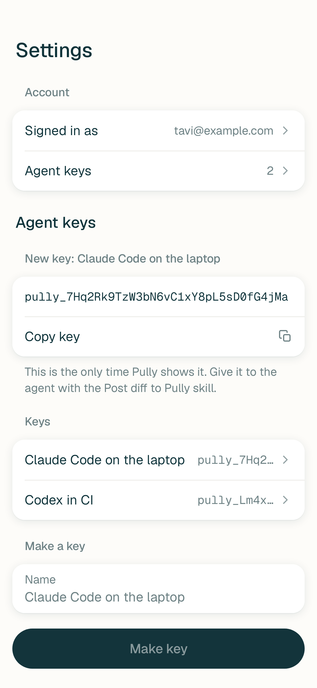
- Pully asks you to sign in once with your account's email and password, then stays signed in.
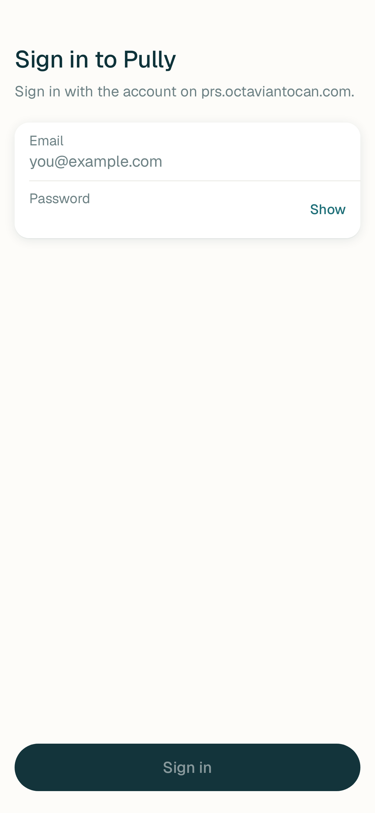
- Your look, fonts, code size, sounds and hidden repositories follow you to any phone signed in to the account.

## 0.42.0

Faster pull requests, a tour you can watch being written, AI costs.

### New

- Stats has an AI usage section: the tokens tours, summaries, analysis and Ask used, what they cost, and which models cost the most. A run whose engine reports no price shows a dash instead of $0.00.
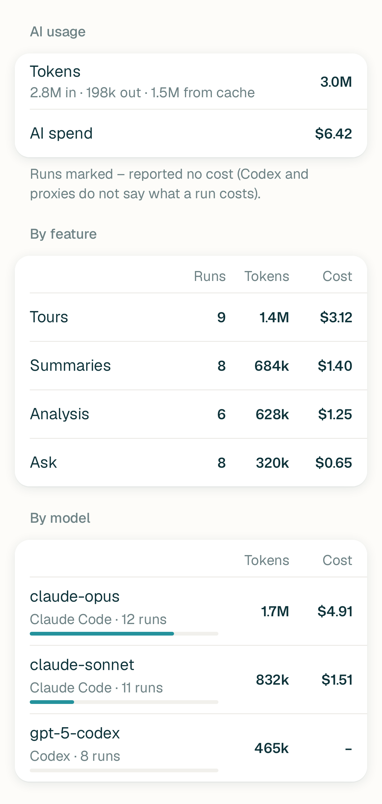
- While a tour is written, its sheet rests at the bottom of the page as a lip you can pull back up, the sections fill in at the top as they are written, and sections still to come show a loader.
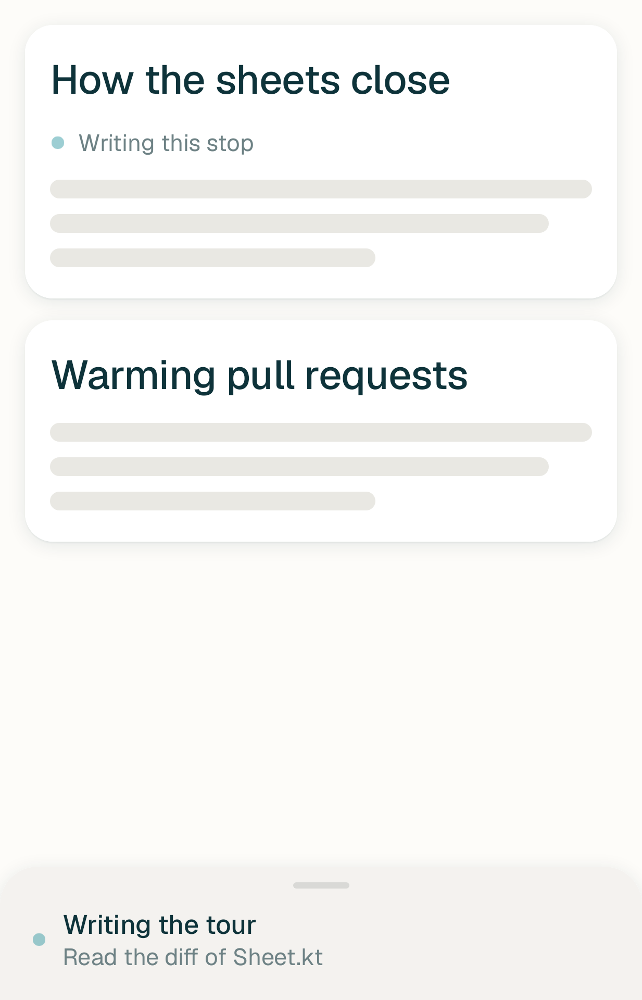
- Tap any finished step in the tour's work log to see more about it, and the log now keeps every step.
- Settings has a GitHub links page that shows what Android has turned on, what to turn on, and why a link tapped in Chrome stays in Chrome.
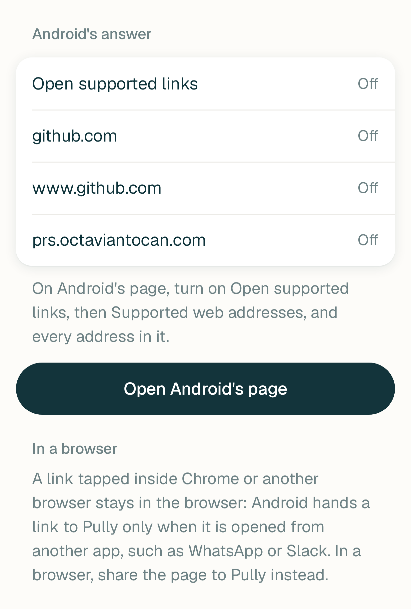
- Touch Profile's graphs: a tap or a drag reads out a day or a month.
- Back on the Inbox asks before Pully closes.

### Better

- Pull requests at the top of the Inbox load before you tap them, and any row starts loading as your finger lands.
- Profile and Stats show their numbers at once, even after a restart.
- A shared link closes the sheet that was open, smoothly, and leaves nothing open when you come back.
- The first swipe on a sheet scrolls it.
- Pinch zoom is smooth, and a swipe between files never stops halfway.
- Holding a pull request shows a card for it and its actions in two groups.
- The "No tour yet" sheet drops its explanation line and sits at the right gap.
## 0.41.0

The app is called Pully now.

### Changed

- Pully is the name under the icon on your home screen, on the update screen and in update notifications.
- Search, Ask, Commands, Settings and the AI's notes on a file say Pully, and so does the web app's header and tab title.

- Nothing to reinstall: this update replaces the app you have, with your sign-in and settings kept.

## 0.40.0

New rows, one Ask bar and a tour that reads like code.

### New

- Pull request rows start with a tile in the colour of their state, so a draft, a merged and a closed one tell apart at a glance. The number, author, checks, changes and age sit on one line, in columns.
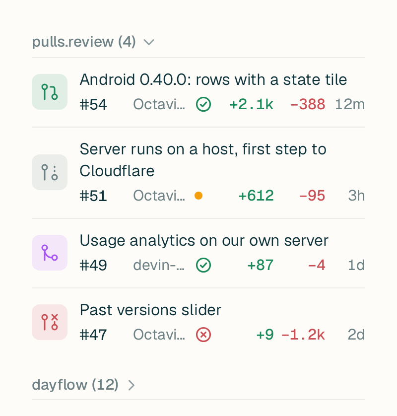
- The search has no Ask button: end your text with a question mark and the ✕ turns into Send.
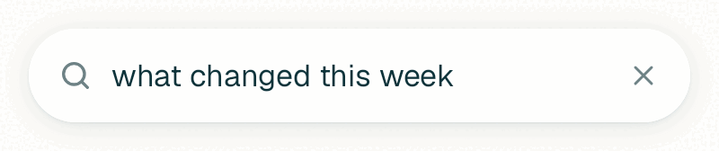
- The Tour and the Overview ask through one bar. Empty, it opens your earlier chats; once you type, it sends and carries on your last conversation. The Overview's review button is a round arrow beside it.
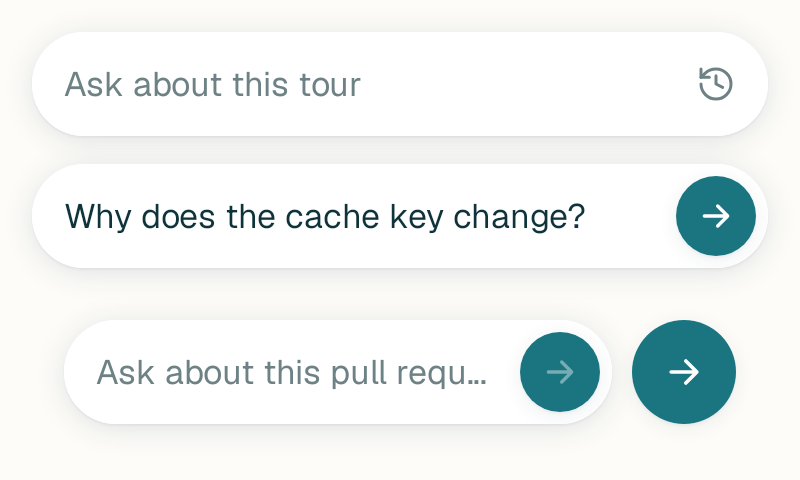
- Flows in a tour are numbered steps on a rail with arrows between them, call trees put each step on its own line, and pseudocode looks like code with its own Copy button.
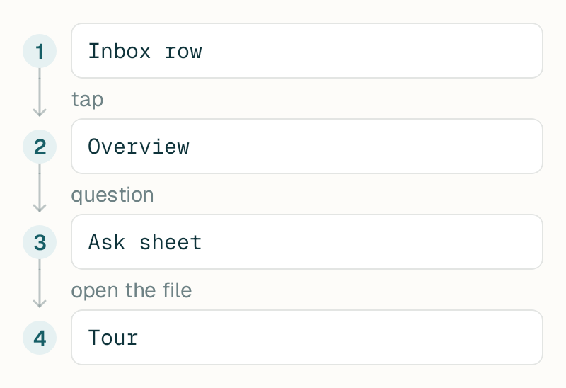
- Settings has a Fonts section: pick the app's font as well as the code font.
- Tour stops fold to their titles, and Commands starts with what you can do on the page you are on.
- File and code names in a tour open the code, even when the AI did not link them, and code links open in Pulls at the line instead of on GitHub.
- The Tour's ⋯ holds the tour's own things: the model, Analyze options and Regenerate.

### Changed

- Headings read "Name (4)" with the arrow right after the count, and numbers in a list line up in one column.
- Every search and Ask field has the same height, corners and text, and words that scroll out of a field fade at its edge.
- The Ask sheet opens tall, stays where you are while an answer streams, and shows the chat through under its field.
- The Overview keeps its title, numbers and tabs pinned as you scroll, and long lists show a few rows and "Show more".
- Conversation starts with what people said, and bots are told from people by what GitHub says.
- File groups that start the same are named once, AI review findings are one plain list with All, Bug, Risk and Nit, and the pull request's ⋯ is shorter.
- Codex's newest Sol, Astra and Luna all sit at the top of the model list.

### Fixed

- The dim behind the Ask bar covers the top bar too.
- The Tour's ⋯ opens at once.
- No grey bars under the thinking line in Ask.

## 0.39.0

Your GitHub year on Profile, plain sheets and a calmer Inbox.

### New

- Profile shows your last year on GitHub: contributions over your recent days, commits, pull requests, reviews, your streak and the year month by month.
- Effort has its own row under Model in Settings and in Analyze, so you no longer scroll past every model to change it.
- Generate tour keeps its sheet open and shows the tour being written there. Close it whenever you like; the tour icon brings it back.

### Changed

- Inbox rows no longer show Jev's kind and risk. Sorting by risk shows one short risk word under the number instead, and rows keep their height.
- Rows no longer archive on a swipe; Archive is in the hold menu. On Tours a swipe left opens the tour and a swipe right goes back to the Inbox.
- Sheets head their sections the way Settings does, with no lines, numbers or arrows, and their search sits further from the close button.
- The summary switch is just the link, with no word before it.
- Pinching the diff makes the text bigger or smaller again, instead of shrinking the whole page.
- Files touch edge to edge as you swipe between them.

### Fixed

- The first swipe from Summary to Conversation no longer jumps.
- Past versions says none are built yet instead of saying the server did not answer, and the server now builds them after each update.
- Generate tour no longer looks broken when tapped before the pull request has loaded.

## 0.38.0

GitHub links open in Pulls: tap one, share it, or select it.

### New

- Share a pull request from Chrome, the GitHub app or any chat, and Pulls opens it. The shared text only has to contain the link.
- Select a link or a name like owner/repo#12 anywhere, and Open in Pulls is in the menu.
- Tapping a GitHub pull request, commit or compare link can now open Pulls instead of the browser. Turn it on in Settings, GitHub links, which opens Android's page for it.

### Fixed

- Tapped GitHub links never reached Pulls before, because the app's link pattern could not match a real address.
- A link that arrives while Pulls is open now opens over the page you were on, so Back returns there, instead of starting the app again.
- A shared text with no link Pulls can open says so instead of quietly opening Home.

## 0.37.0

Usage stats on your own server, and a Stats page in Settings.

### New

- Pulls now counts what you do in it, such as pull requests opened, files reviewed, searches and how long pages take, and sends the counts only to your own server.
- It never sends what you read or type: no code, file names, searches, questions or comments.
- Settings has a Usage stats switch, on to begin with. Turning it off deletes anything not yet sent and stops counting.
- Settings, Stats shows the last 7, 30 or 90 days: sessions, pull requests opened, files reviewed, AI runs and spend, a bar for each day, time on each page, the slowest server calls and what went wrong.
- Counts made without a network are kept on the phone and sent once it is back, and a crash is noted and sent the next time Pulls opens.

## 0.36.0

Open any past version of the app from a slider in Settings.

### New

- Settings, Advanced, Past versions has a slider across every version of the app, from 0.4.0 to the one you're running.
- Slide to an older version and tap Get: it downloads, installs beside this app and opens as it was then, on your server.
- Once a version is on the phone, Open brings it up at once, and Remove takes it off again.
- Past versions have no icon of their own and never ask to update; this app stays on the newest version.

## 0.35.0

Chat history in Ask, tour previews, and smoother swipes and zoom.

### New

- Ask keeps your earlier chats: with nothing typed, the button opens them in a list you can search, and a tap brings one back.
- While a tour is written, its stops show under the progress as they are planned and written, without moving the page.
- A file or line the tour names opens that file's changes in a sheet, and the tour stays where you were.
- Answers in Ask can use the tour's tables, trees, steps, flows and diagrams.
- The theme list and the model list have a search.
- The "No tour yet" sheet lets you pick the effort under the model.
- File groups on the Summary and in Files show their added and removed lines.

### Changed

- A sideways swipe anywhere on the Inbox, even on a pull request, goes to Tours.
- Every heading on Home stays whole at the top as you scroll, and all their arrows line up.
- Swiping between Summary and Conversation follows your finger and no longer turns the page by itself.
- Going from one file to the next is easy: a third of the way or a flick is enough, and it never slides back.
- Pinching code zooms it without dragging the page around, in the diff and on the tour.
- The pull request page fades softly under its tabs and under the bottom buttons, with no hard edges.
- The bottom buttons stay put while you pull down for Commands.
- Review is never greyed out while a pull request opens, and the Jev line no longer flickers.
- Tapping the description opens it in an editor on a sheet; the title still edits in place.
- Badges in descriptions are sharp and open their link.
- Tapping the author no longer opens their GitHub profile.
- On the Commits sheet, tapping the chosen commit again goes back to all commits, and a held range is easy to see.
- The model list shows at once instead of loading each time, and Pi models named with an effort only offer that effort.
- Ask's progress looks like the tour's, the loader sits in the button, and scrolling up while it writes keeps you there.
- New chat opens at once, and an empty chat offers its first questions the way answers offer the next ones.
- Pseudocode in tours reads as plain steps, code blocks lose their "Code text" label, and "In the code" notes say what each place does.
- Check groups have a line under them, and comment cards give Resolve some room.

## 0.34.0

A new app icon: a beam of light across a grid of days.

### Changed

- The app icon is now Torch: a contribution grid of days with a beam of light from one corner lighting a wedge of them.
- Themed icons and the update notification show the beam on its own.

## 0.33.0

Colour themes, Commits and Checks as sheets, and a steadier diff.

### New

- Themes: pick one of OpenCode's colour themes in Settings or from Commands.
- Commits opens a sheet like Files, with "Find a commit" and the commits folded by day. Tapping one shows the changes of that commit alone.
- Checks opens the same kind of sheet, with "Find a check", short names and passing checks folded away.
- Hold a line of code to ask about it, copy where it is or copy its GitHub link.
- Code contracts: Settings, Advanced, UI Book lists every rule the app keeps, by area and kind.

### Changed

- The pull request page keeps its tabs pinned under the buttons when you scroll, and nothing slides over the buttons any more.
- Summary and Conversation are the only tabs, closer together, and a swipe past the last one goes nowhere.
- The bar with a file's counts and Reviewed stays still while you swipe between files; only its words change.
- Swiping past the last file no longer opens the Tour, and a swipe can no longer get stuck between two files.
- The comment bar is just the field and Send.
- The AI summary and the description switch with a quiet link instead of a pill.
- Files lists show added and removed lines side by side, as the Inbox does.
- The page has its final shape while a pull request opens, so nothing jumps.
- A pull request someone else opened has no Archive swipe, and its title and description can't be edited.
- Home's folded projects never stop half hidden under the chips.
- Pi's model list has each model once, grouped by provider, with no image models.
- Tours use tables, lists, flows and code where they fit, and their stops come onto the page one after another.
- The tour's Ask bar works like Home's search, and the page dims behind it.
- A tour being written shows fewer, calmer steps.
- Commands is ready to type as soon as it opens.

## 0.32.0

Pull requests show their kind and risk, and files their rating.

- A pull request Jev has read says what kind of change it is and how risky, under its name in the Inbox and under the branch on its page.
- Every rated file says "Needs a look", "Worth a look" or "Skim".
- Jev reads a pull request when it is analysed, and the AI uses its ratings to decide where to look first.
- The Inbox asks Jev about every pull request only while it is sorted by risk or grouped by kind.

## 0.31.0

Sheets open into pages, risky actions ask first, Commands anywhere.

### New

- Pull down on any page for Commands. Commands opens ready to type.
- In a pull request's ⋯ sheet, everything you open slides in as a page with Back, and the phone's Back goes back a page.
- Approve, request changes, merge, close and draft sit one page in, under Approve, merge or close, and each asks before it acts.
- Summary, Commits and Conversation sit side by side: swipe anywhere on the page, even the title, and the tab marker moves with you.
- Swiping between pages keeps your place, so the Inbox is still where you left it after a look at Tours.
- Changes: files sit side by side as you move between them, the counts line stays at the top, and colours show sooner.
- Conversation: chips show only what people wrote, or only the bots.
- Sound is now a page in Settings, and What's new reads like a proper changelog.

### Fixed

- Sheets bounce a little less, rise smoothly when the keyboard opens, and you feel them arrive.
- Moving between Inbox and Tours no longer snaps at the end.
- The ringing tap sound is gone; buttons click.
- Light and Dark only sweep when the look actually changes.
- The branch names and your profile photo show at once.
- Folding sections looks and moves the same everywhere, and the Files and Checks sheets use cards.
- Holding, folding and swiping feel the same on every page.
- Starting a tour shows its progress right away, it never flashes the start page at the end, and Back from a linked file returns to the same place.
- Links to files in hidden folders like .agents open the file instead of a missing page.
- Rows that scroll sideways fade at their edges.

## 0.30.0

Tours start from the tour icon, and sort sits next to search.

- A pull request opens on its description, with no Analyze card above it.
- Tap the tour icon on a pull request without a tour: pick the model and generate one. The tour page shows the work as it is written.
- Sort is the round button next to the search at the bottom of the Inbox, always in reach.

## 0.29.0

Screens slide side by side, sheets bounce, and taps are felt.

- Inbox and Tours sit side by side: tap or swipe between them. Summary, Commits and Conversation, and the files in Changes, slide whole too, with no fade.
- Pages inside a sheet move far enough to see which way they went, and Back goes to the right.
- Sheets rise from the bottom with a little bounce, Commands too, and scrolling a sheet's content back up no longer closes it.
- Taps, swipes and results vibrate. Settings has a Vibration switch under Sounds.
- Switching Light and Dark sweeps the new look in from a corner.
- Settings shows the model's name, keeps Server under Advanced at the bottom, drops three explanations, and lets you pick Split on any phone.
- Profile: tap your photo or name for your GitHub profile. Commands and the server address are gone, and the list sits closer.
- Inbox: names stay on one line, a stacked pull request shows its place, like 2/10, under its number, and holding a row opens its actions.
- The search dims the list as soon as you tap it, and the dim lifts a little slower.
- Repository headings no longer slide over the filter chips.
- A repository's page opens with its list straight away, because the server keeps it ready.
- Tours: a repository heading opens that repository's tours, and a finished tour shows a tick without "Read".
- A pull request shows its size at once. Its branch stays on one line and scrolls sideways, and only the part under the tabs swipes between them.
- Tapping a title puts the caret where you tapped, and the rest of the page fades while you edit.

## 0.28.0

Updates are required now, and tours you have opened load at once.

- When a new version is out, Pulls opens on it: what it brings, and Update. The app waits until you update.
- Commands has Update Pulls, which checks for a new version and installs it, and What's new.
- A tour you have opened is kept on the phone, so it shows straight away, before the rest of the pull request loads.
- Tours on the Tours list are saved to the phone in the background, including ones written while the app was closed.

## 0.27.0

Pi joins Claude Code and Codex: any model from your own API.

- The model picker has a third tab, Pi. It lists every model your server's API offers, such as Claude, GPT and Gemini models through CLIProxyAPI, with the newest of each family first.
- Analysis, reviews, tours, briefs, questions and Ask about your inbox all run on the model you pick there, the same way they do on Claude Code and Codex.
- Until the server is set up for it, the Pi tab says what the server needs.

## 0.26.0

Fixes for stacks, Jev groupings, AI reviews and huge pull requests.

- Jev's kinds and risk show up on Home as soon as they are ready, without leaving and coming back.
- On a TypeSafe plan with lower limits, Jev slows down instead of leaving pull requests unsorted.
- A pull request's stack shows again after it reloads, and unusual branch setups no longer show a stack that isn't there.
- Review with AI lists the review skills of the server you are connected to.
- "Needs a look" marks are cleared when a pull request gets new commits.
- A huge pull request that gets new commits while you read it never mixes in code from before.

## 0.25.0

Everything still missing from your walkthrough video is now in.

- Every sheet rests at two heights. Profile and Commands open at the normal one and pull up to tall, and Commands waits for a tap before the keyboard comes up.
- Commands opened from Profile slides in inside Profile.
- There is no Refresh anywhere. Pulls reloads when you come back to it, and new commits on a pull request load by themselves.
- Dark mode is a neutral grey everywhere, the launch screen included, and Settings shows real code for the diff layouts.
- Long names wrap instead of being cut short.
- Selecting lines in the Diff turns the bottom bar into the comment bar, with nothing floating over the lines. Its ⋯ asks about the lines, copies them or copies their GitHub link.
- Pinch zoom keeps the line under your fingers in place.
- Swipe from the Tour back to the Diff, or past the last tab of a pull request on to the Diff.
- File rows open with the same swipe as pull request rows.
- In a tour, pseudocode is coloured, call trees and file trees are drawn, and "In the code" no longer squeezes its text.
- While the AI works you see its latest thinking and the answer as it is written, and its sources include the files it read.
- Every file or line the AI mentions is a link, in notes, findings and answers too, and in what it posts on GitHub.
- Claude's models show their version, and each one's usual effort is marked Recommended.
- The Tours tab hides the repositories you chose to hide.

## 0.24.0

Huge pull requests open at once.

- The title, description and conversation show right away, even on pull requests with thousands of changed lines.
- The server keeps a copy of your open pull requests, so they open from it instead of waiting on GitHub.
- On a big diff, each file's code loads as you reach it.

## 0.23.0

Group pull requests by kind and see the riskiest first.

- When the server has Jev, TypeSafe's classifier, the Sort sheet adds Riskiest first and a Group by choice: by repository or by kind, such as fixes, features and refactors.
- Grouped by kind, each row names its repository next to the author.
- In a pull request's files, the ones Jev thinks need a closer look say "Needs a look".

## 0.22.0

Swipes and pages now move the way your finger goes.

- Swipe between a pull request's tabs and the rows follow your finger, then carry on to the tab you went to instead of springing back first. A quick flick is enough.
- The line under the tabs leans toward the next tab as you drag and slides across when it changes.
- Next, previous and Back move the way they say: the next tab, file or view comes in from the right, and Back always slides backward.
- A back swipe moves the page with your finger, then carries it off the way you swiped.
- The back button and the Overview, Changes and Tour switch stay still when you change view, and the switch's highlight slides.
- The file name at the bottom of the diff and the stop on the Tour slide the way you went.
- The filters and the activity strip move with the Inbox when you switch to Tours.
- Commands, pulled down from the top, drops from the top and goes back up.

## 0.21.0

Review with AI now offers only the review skills chosen for it.

- The More sheet has one Review with AI row. It opens a short list: General, then each review skill by its name and what it looks for.
- The list shows only the skills chosen for reviews, not every skill on the server computer.
- A tap starts the review, and a tick marks the one this pull request was last reviewed with.

## 0.20.0

See which pull requests are stacked on others.

- A pull request that sits on another shows a stack mark on Home, with the number of the one under it.
- On the pull request, a chip under the title says what it is stacked on. Tap it to see the whole stack, top to bottom, and open any other layer.

## 0.19.0

New versions float above the search and notify your phone.

- When a new version is ready, a card floats just above the search on Home. Tap it to read what's new, or tap Update to install it.
- Pulls checks for new versions in the background and sends a notification when one is out. Its Update button opens the app and starts the download.
- After an update, a sheet like this one opens once to show what changed.
- Settings has a What's new page to read it again, and a switch for the update notifications.

## 0.18.0

Sort the Inbox and fold its repositories.

- A chip after the filters says how the Inbox is sorted. Tap it to sort by recently updated, least recently updated, PR number or largest change.
- Tap a repository's heading to fold its pull requests away, or tap its name to open the repository. Folds are kept, and a search opens them all.
- While you scroll, a repository's heading stays at the top until the next one takes its place.

## 0.17.0

Summary and Description are one tab.

- A pull request's tabs are Summary, Commits and Conversation, all there from the start.
- Summary shows the author's description until an analysis writes a summary. Then a switch over the text moves between the two.

## 0.16.0

Ask a question from the Home search.

- Type a question in the search on Home and tap Ask. Claude Code or Codex answers it from your open pull requests and the ones closed in the last month.
- Pull requests the answer names open with a tap, and the conversation is kept.

## 0.15.0

Small fixes where the app still looked unlike the design.

- No more speech bubbles or progress counters.
- Tours rows look like Inbox rows.
- More has a switch to merge when checks pass.
- Stop is the turning orb wherever something runs, and every retry is the same arrow.

## 0.14.0

AI answers show code like the diff, and what they mention opens.

- Code in a tour, the brief or an answer uses the diff's code view, and flows are drawn.
- Files and lines an answer mentions are links into the diff.
- Ask answers have source chips, copy and redo, and suggest follow-up questions.

## 0.13.0

The Tour and Ask, reworked from the walkthrough.

- The Tour strip is a ring that fills as you scroll, and its sections open as a sheet.
- Ask replies are plain text, with a new-chat button instead of Clear.
- Tables in AI text keep readable columns and scroll sideways.

## 0.12.0

The Diff's file name sits between the arrows.

- Tap the file name at the bottom of the Diff to open Files, with search and folding sections.
- Swipe sideways to move to the next file.
- Commits have their own tab.
- The Home list dims while the search waits for you to type.

## 0.11.0

The Analyze card keeps one height, and the model list is shorter.

- Tap the orb to stop an analysis.
- The model list shows the newest models first, with older ones below.

## 0.10.0

Pull requests slide in and edit in place.

- Edit a pull request's title and description in place.
- Commits, Checks and Files are plain lists with whole titles.

## 0.9.0

Sheets rest at half height and lift to full.

- Pages inside a sheet slide sideways and keep their place when you go back.
- Settings and Profile are rebuilt, and Profile can hide a repository from the Inbox.
